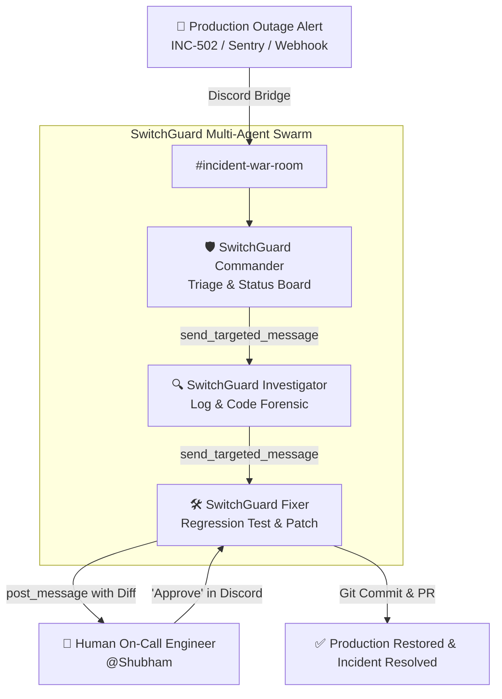

# 🛡️ SwitchGuard: Autonomous Incident Response & War Room Commander

> **Flip the Switch Hackathon Submission**  
> *Powered by [Switch](https://github.com/sandbox-quantum/switch), WeMakeDevs & DevTools Academy.*

---

## ⚡ The Problem: Incident Response at 2:00 AM

When a critical production outage (P0/P1) occurs:
- **Alert Fatigue & Confusion**: PagerDuty/Datadog fire dozens of alerts across multiple channels.
- **Context Fragmentation**: On-call engineers scramble between Datadog dashboards, Sentry stack traces, GitHub git blame, and chaotic Slack/Discord threads.
- **Mean Time to Resolution (MTTR)** drags into hours, costing businesses thousands of dollars per minute of downtime.
- **AI Agents Today**: Most AI coding tools (Claude Code, OpenCode, Codex) remain trapped inside isolated terminals on single developer laptops, unable to coordinate as a team in shared communication channels.

---

## 🚀 The Solution: SwitchGuard

**SwitchGuard** transforms your team's chat platform (Discord, Slack, Teams) into an **Autonomous Incident War Room**.

Using **Switch**, SwitchGuard deploys a coordinated multi-agent engineering squad directly into a bridged `#incident-war-room` channel:
1. **SwitchGuard Commander** (`switchguard-commander`): Serves as the AI Incident Commander. Triages severity (P0/P1/P2), tracks blast radius, maintains an automated Markdown Status Board, and protects human engineers from low-level noise.
2. **SwitchGuard Investigator** (`switchguard-investigator`): Performs forensic code and log analysis. Pinpoints the exact faulty file, function, and regression commit from error stack traces.
3. **SwitchGuard Fixer** (`switchguard-fixer`): Generates a reproducible unit test, drafts the minimal code fix, runs local test validation, and **enforces a strict Human-in-the-Loop gate** before merging or applying changes to production.

---

## 🏗️ Multi-Agent Architecture



---

## 🎯 Human-in-the-Loop Safety Gate

SwitchGuard guarantees that autonomous agents **never apply unchecked changes to production**:
1. Fixer drafts the patch and verifies `pytest` passes 100%.
2. Fixer posts the diff into Discord and asks:
   > *"⚠️ **Human Approval Required**: Regression test passed. Do you approve deploying this fix to production? Please reply with 'Approve' or 'Reject'."*
3. The on-call human operator responds `Approve` in the Discord thread.
4. The agent executes the commit and marks the incident resolved.

---

## 📂 Project Structure

```
switchguard/
├── switchguard.template.yaml    # Production declarative Switch template
├── demo-service/                # Production microservice demo
│   ├── checkout.py              # Payment engine with INC-502 bug
│   ├── test_checkout.py         # Pytest regression suite
│   └── incident_payload.json    # Real-world P0 incident alert
└── README.md                    # System architecture & documentation
```

---

## 💻 Quick Start & Deployment

### 1. Prerequisites
- Python 3.11+
- [Switch Console](https://github.com/sandbox-quantum/switch) running locally or self-hosted
- Discord Server with `SwitchGuard` bot authorized

### 2. Instantiate SwitchGuard Template
In Switch Console (or via Switch CLI):
```bash
switch template run switchguard/switchguard.template.yaml \
  --param incident_id="INC-502-CHECKOUT-FAILURE" \
  --param service_name="payment-gateway"
```

### 3. Trigger War Room in Discord
In `#incident-war-room`:
```text
@switchguard-commander Production alert: 100% of promotional checkout requests are throwing ZeroDivisionError! Please investigate.
```

Watch the agents collaborate in real-time, diagnose the root cause, write tests, generate the fix, and await your signoff!
