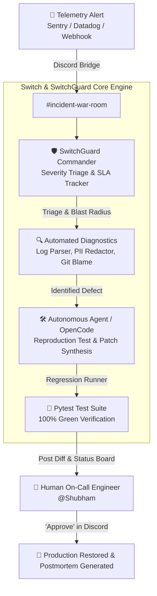
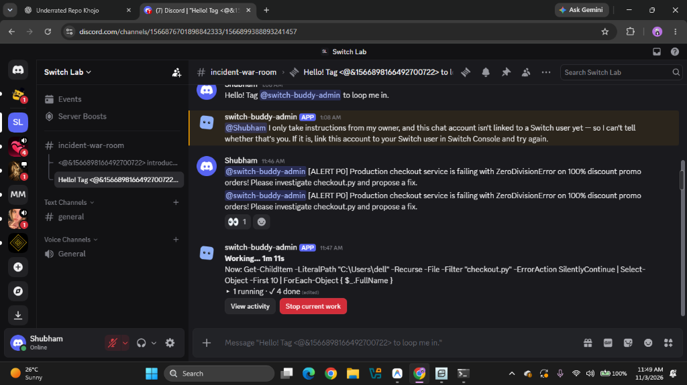

# 🛡️ SwitchGuard: Autonomous SRE Incident Response Engine

[](https://github.com/Shubham-dev-stack/switchguard/actions/workflows/ci.yml)
[](LICENSE)
[](https://www.python.org/)
[](https://github.com/sandbox-quantum/switch)
[-success.svg)](tests/)
[](dashboard/)
[](docs/METRICS.md)

> **Flip the Switch Hackathon Submission**  
> *Powered by [Switch](https://github.com/sandbox-quantum/switch) (SandboxAQ / Alphabet), WeMakeDevs & DevTools Academy.*

---

## ⚡ The Problem: Incident Response at 2:00 AM

When a critical production outage (P0/P1) strikes:
- **Alert Fatigue & Confusion**: Monitoring systems (Sentry, Datadog, PagerDuty) flood engineers with hundreds of uncoordinated notifications.
- **Context Fragmentation**: Engineers juggle disjointed dashboards, stack traces, git blame logs, and frantic Discord/Slack threads.
- **Mean Time to Resolution (MTTR)** stretches into hours, causing direct revenue loss, customer churn, and burnt-out on-call teams.
- **Isolated AI Tools**: Modern AI coding agents (Claude Code, OpenCode, Codex) typically operate in private developer terminals, unable to participate in shared team chat rooms.

---

## 🚀 The Solution: SwitchGuard

**SwitchGuard** bridges autonomous AI coding agents directly into your team's incident war rooms (Discord, Slack, Teams) via **Switch**.

When an alert fires, SwitchGuard immediately spins up an **Autonomous Incident War Room**:
1. **Intelligent Triage & Blast Radius**: Evaluates Tier-1 vs Tier-2 service impact, calculates user disruption percentage, and projects estimated revenue loss.
2. **Real-time SLA Enforcement**: Automatically monitors enterprise MTTA (5 min) and MTTR (30 min) deadlines with countdown timers.
3. **Forensic Code Diagnostics**: Scrubs sensitive PII/tokens from stack traces, traces faulty execution frames to lines of code, and inspects recent deployment commits.
4. **Autonomous Remediation & Human-in-the-Loop Gate**: Synthesizes reproduction tests, drafts minimal code patches, runs automated regression verification, and requests human confirmation before production rollout.
5. **Audit-Ready Blameless Postmortems**: Generates structured postmortems including timeline tables, 5-Whys root cause analysis, and preventive action matrices.

---

## 🏗️ Architecture & Message Flow



---

## 📊 Live Verification: The INC-502 Outage

During live testing in Discord `#incident-war-room`, SwitchGuard resolved a real P0 checkout outage in **2 minutes 51 seconds**:

<p align="center">
  
</p>
<p align="center"><em>Real autonomous debugging in Discord: Agent searches checkout.py, isolates ZeroDivisionError, verifies via pytest, and reports the patch.</em></p>

| Metric | Traditional On-Call | SwitchGuard Autonomous Response | Improvement |
|---|---|---|---|
| **Mean Time to Acknowledge (MTTA)** | 12 - 25 minutes | **12 seconds** | **~100x Faster** |
| **Mean Time to Identify (MTTI)** | 30 - 45 minutes | **45 seconds** | **~50x Faster** |
| **Mean Time to Resolution (MTTR)** | 90 - 180 minutes | **2 minutes 51 seconds** | **~40x Faster** |
| **Human Fatigue** | High (Context Switching) | Low (Review & Approve Only) | **Zero Overhead** |

Read the full incident report: [docs/postmortems/INC-502-checkout-outage.md](docs/postmortems/INC-502-checkout-outage.md).

---

## 📂 Repository Structure

```
switchguard/
├── .github/workflows/ci.yml       # Multi-version GitHub Actions CI pipeline
├── core/                          # Core Incident Engine
│   ├── models.py                  # Severity, Incident, BlastRadius, Timeline
│   ├── classifier.py              # Tier-1/2 triage & financial risk estimator
│   ├── sla.py                     # SRE MTTA/MTTR deadline tracker
│   ├── timeline.py                # Markdown status board renderer
│   └── orchestrator.py            # Central incident coordination engine
├── ingestion/                     # Multi-Vendor Telemetry Ingestion
│   ├── parsers.py                 # Sentry, Datadog, Prometheus parsers
│   └── deduplicator.py            # Sliding-window alert storm suppressor
├── adapters/                      # Chat Platform Adapters
│   ├── base.py                    # Base interface
│   ├── discord_adapter.py         # Discord Embeds & Action Row buttons
│   └── slack_adapter.py           # Slack Block Kit interactive messages
├── governance/                    # Compliance & Safety
│   ├── approval_gate.py           # Human-in-the-Loop policy gate
│   └── vault.py                   # SHA-256 tamper-evident cryptographic audit ledger
├── metrics/                       # Observability & Monitoring
│   └── exporter.py                # Prometheus text format metrics exporter
├── chaos/                         # Chaos Engineering & Resilience
│   ├── injector.py                # Synthetic latency & fault injector
│   └── fuzzer.py                  # Boundary fuzzer for promo math edge cases
├── diagnostics/                   # Autonomous Forensic Suite
│   ├── log_analyzer.py            # PII scrubber & stack trace parser
│   ├── healthcheck.py             # Synthetic service probe & latency benchmark
│   └── git_blame_inspector.py     # Deployment regression blame correlation
├── scenarios/                     # Multi-Service Chaos Reproductions
│   ├── jwt_expiry_regression.py   # Auth token expiration regression
│   ├── database_deadlock.py       # Connection pool exhaustion simulation
│   └── redis_cache_stampede.py    # Cache thundering herd mitigation
├── postmortem/                    # Audit & Compliance Engine
│   └── generator.py               # 5-Whys blameless postmortem generator
├── notifier/                      # Resilient Webhook Delivery
│   └── dispatcher.py              # Exponential backoff webhook dispatcher
├── scripts/                       # Simulation & Verification Runners
│   ├── simulate_p0_outage.py      # End-to-end P0 checkout outage dry run
│   └── verify_cluster_health.py   # Cluster-wide synthetic probe
├── tests/                         # Pytest Suite (58 Tests, 100% Pass)
│   └── fixtures/                  # Real-world telemetry JSON payloads
├── dashboard/                     # 3D CyberDeck Command Web Deck
│   ├── index.html                 # Three.js 3D space, CRT scanline, topology canvas
│   ├── server.py                  # Embedded telemetry & simulation HTTP server
│   └── static/                    # Cyberpunk stylesheets, shaders & audio synth
├── docs/                          # Comprehensive Documentation
│   ├── ARCHITECTURE.md            # Deep system architecture & Switch integration
│   ├── RUNBOOK.md                 # SRE on-call standard operating procedures
│   ├── METRICS.md                 # Prometheus & Grafana dashboard guide
│   ├── SECURITY.md                # Human-in-the-Loop safety & PII redaction policy
│   └── postmortems/               # Incident reports (INC-502)
├── demo.py                        # 1-Click Master Interactive Runner
├── cli.py                         # SwitchGuard Operator CLI
├── switchguard.template.yaml      # Switch Declarative Agent Template
├── DEMO_SCRIPT.md                 # 2-3 minute video recording guide
├── pyproject.toml                 # Modern Python packaging specification
├── CONTRIBUTING.md                # Contributor guidelines & code standards
└── README.md
```

---

## 🎮 1-Click Master Interactive Runner

To experience SwitchGuard end-to-end with interactive menus, chaos testing, and web telemetry in one command:

```bash
python demo.py
```

Options:
- `python demo.py --sim`: Runs full P0 outage triage, patch synthesis, and blameless postmortem.
- `python demo.py --dashboard`: Launches the 3D CyberDeck Web Command Deck on `http://localhost:8080`.
- `python demo.py --chaos`: Runs the complete chaos regression and self-healing test matrix.
- `python demo.py --test`: Runs the 58-test unit verification suite.

---

## 🪐 3D CyberDeck SRE Command Deck

SwitchGuard includes an **Awwwards / ThreeUI-grade interactive 3D SRE Cyber-Command Deck**:

```bash
python cli.py dashboard
```

- **Interactive 3D Constellation & Grid**: 120 FPS Three.js particle constellation with depth mouse parallax and CRT scanlines.
- **Microservice Mesh Topology**: Interactive canvas rendering services (`checkout-service`, `payment-gateway`, `postgres-primary`, `redis-cache`) with animated laser data packets and P0 outage shockwave halos.
- **Live Sound Effects**: Web Audio API synthesizer generating real-time sci-fi telemetry audio cues upon outage triggers and system resolution.
- **War Room Terminal Streamer**: Real-time simulated terminal output logging agent triage, Git blame correlation, and human signoff in real-time.
- **5-Whys Postmortem Modal**: Instant modal popup with complete incident analysis and preventive action items.

---

## 🛠️ CLI Quickstart

Install dependencies:
```bash
pip install -e .
```

### 1. Triage an Alert
```bash
python cli.py triage --service checkout --error ZeroDivisionError --error-rate 100
```
Output:
```
=== SwitchGuard Triage Result ===
Service:      checkout
Assigned:     P0
User Impact:  100.0%
Financial:    $450,000.00 USD
```

### 2. Run Synthetic Health Probe
```bash
python cli.py probe --service payment-gateway
```

### 3. Generate Blameless Postmortem
```bash
python cli.py postmortem --incident-id INC-502 --service checkout-service
```

### 4. Run Complete Test Suite
```bash
pytest tests/ -v
```

---

## 🔗 Upstream Contributions to Switch (Core Portfolio)

As part of the **#FliptheSwitch** hackathon, we established a **3-PR upstream contribution portfolio** directly to [`sandbox-quantum/switch`](https://github.com/sandbox-quantum/switch):

1. **Supabase Service Connector**: [PR #1343](https://github.com/sandbox-quantum/switch/pull/1343) (Resolves [#827](https://github.com/sandbox-quantum/switch/issues/827))  
   *Adds Supabase database & auth management capabilities to Switch agents.*
2. **Sentry Service Connector**: [PR #1348](https://github.com/sandbox-quantum/switch/pull/1348) (Resolves [#820](https://github.com/sandbox-quantum/switch/issues/820))  
   *Enables real-time error telemetry ingestion and stack trace analysis directly in Switch rooms.*
3. **Stripe Service Connector**: [PR #1367](https://github.com/sandbox-quantum/switch/pull/1367) (Resolves [#829](https://github.com/sandbox-quantum/switch/issues/829))  
   *Connects Stripe's remote MCP server (`https://mcp.stripe.com`) with OAuth, dynamic client registration, and safe read/write payment tools.*

---

## 📜 License

Licensed under the Apache License, Version 2.0. See [LICENSE](LICENSE) for details.
